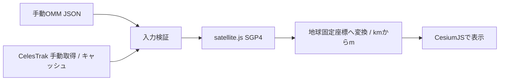

# ORBIT — Orbital Object Explorer

公開軌道要素をSGP4で指定時刻へ伝播し、3D地球上に可視化する個人開発の技術展示アプリです。

CesiumJSによる地球描画と、satellite.jsによる軌道伝播を統合しています。独自の衛星観測・検出・軌道決定を行うものではありません。

## GitHub Pages

[ブラウザで開く](https://anyspoc.github.io/orbit-explorer/)

最初は「データ取得」を押すか、権限を確認したOMM JSONを読み込んでください。ページを開くだけでは外部の軌道データを自動取得しません。

GitHub標準のブランチ配信を使い、`dist`だけを`gh-pages`ブランチへ公開します。[今回のライセンス・配布確認](docs/PUBLICATION-REVIEW.md)を参照してください。

更新時は、変更をコミットして`origin/main`へプッシュした後に実行します。

```sh
npm run publish:pages
```

公開スクリプトは、作業状態・AnySpOC名義・認証アカウント・公開先・ソースの同期を確認し、テストとライセンス検査の成功後に配信ブランチを通常プッシュします。履歴の書き換えや強制プッシュは行いません。ソースのプッシュだけでは配信ブランチを更新しません。

## 機能

- 衛星・ステーション・デブリのカタログ選択と検索
- 指定時刻の推定位置、選択物体の高度・速度・軌道周期の表示
- 一時停止、早送り、現在時刻への復帰
- 選択時刻から1周分の予測経路の表示
- OMM JSONの手動読み込みと入力検証
- 利用者の操作によるCelesTrakからの取得、取得間隔制限とエラー時停止

初回表示時は軌道データを自動取得しません。「データ取得」を押すか、「データ / 出典」から利用権限を確認したJSONを読み込んでください。衛星は点で表示します。

## ローカル起動

```sh
python -m http.server 8080 --directory dist
```

ブラウザで `http://localhost:8080` を開きます。WebGL対応の現行ブラウザと、CDNからライブラリ・地球画像を読み込むネット接続が必要です。APIキーは不要です。

## テスト

Node.js 22以降で実行できます。依存パッケージのインストールは不要です。

```sh
npm test
```

配布ライセンス・相対リンク・除外対象の検査：

```sh
npm run verify:publication
```

取得頻度、エラー時停止、入力の数値・日時・ID・件数検証、HTML注入の回帰防止、ライセンスの同梱など32項目をテストしています。テストの軌道要素は合成値で、実在衛星のデータではありません。テスト成功は軌道精度を保証しません。

## 構成

| ファイル | 役割 |
| --- | --- |
| `dist/validation.js` | OMMの形式・範囲・重複検証 |
| `dist/catalog.js` | 取得間隔、保存データ、エラー時停止 |
| `dist/app.js` | 伝播ライブラリ・座標変換・3D表示・UIの統合 |
| `dist/credits.html` | 出典、ライセンス、外部通信の説明 |
| `dist/licenses/` | 独自コードと第三者OSSのライセンス全文 |
| `tests/` | 取得方針・入力検証・表示安全性の回帰テスト |



SGP4アルゴリズムと描画エンジンは第三者OSSを使用しています。このアプリでは、取得制御、入力検証、ライブラリ統合、表示・検索・時刻操作を実装しています。

## データ・精度の制限

- 位置は公開軌道要素からの推定で、観測によるライブ位置ではありません。
- 簡易な恒星時を使った座標変換です。厳密な地球姿勢補正、実観測や独立実装との精度比較は未実施です。
- 古い要素やマヌーバで誤差が増えます。航行・運用上の接近警報・衝突回避には使わないでください。
- 軌道線は選択時刻から1周分の地球固定座標での予測経路です。連続した軌道線の再計算は今後の課題です。
- JSONは12 MiB、25,000件まで。数値範囲の不正、重複ID、未対応の時刻系・座標系は拒否します。
- 大規模カタログの計算はメインスレッド上で行います。性能は端末に依存します。

## 外部サービスと利用条件

CelesTrakの取得は選択カタログのみ、同一ブラウザ・同一オリジンで最短2時間（GPSは24時間）に制限しています。強制更新・自動再試行は行わず、通信エラー後は停止します。異なる利用者間の取得総量を制御するものではありません。データ自体はこのリポジトリに同梱していません。

- [CelesTrakの利用方針](https://celestrak.org/usage-policy.php)
- [GPデータ形式](https://celestrak.org/NORAD/documentation/gp-data-formats.php)

地球画像はNatural Earth IIです。Cesium標準の星空・太陽・月は無効化しています。Cesium ionの画像・地形・ジオコーダーは利用しません。Cesiumの標準クレジットロゴが表示されますが、ion APIを使用する構成ではありません。

- [Natural Earthの利用条件](https://www.naturalearthdata.com/about/terms-of-use/)

Cesium公式CDNとjsDelivrから第三者コード・アセットを読み込みます。手動ファイルは端末内で処理し、アップロードしません。データを同梱・再配布する場合や、公開デモの利用規模・用途を変える場合は、提供元条件を別途確認してください。

## ライセンス

独自コード・文書：MIT License、Copyright (c) 2026 AnySpOC。[全文](LICENSE)

| 第三者要素 | 使用版 / 条件 |
| --- | --- |
| CesiumJS | 1.146 / Apache-2.0および同梱第三者コードの条件。全文は `dist/licenses/CesiumJS-LICENSE.txt` |
| satellite.js | 6.0.1 / MIT。全文は `dist/licenses/satellite-js-LICENSE.txt` |
| Natural Earth | 地図データは提供元がパブリックドメインと明示 |
| 軌道データ | 取得元・提供者の条件。独自コードのMIT許諾の対象外 |

第三者OSS・画像・データの条件を、このアプリのMITライセンスで置き換えるものではありません。[権利に関する補足](RIGHTS.md)と[表示用の出典ページ](dist/credits.html)も参照してください。提供者による公式製品・提携・承認を示すものではありません。
